
<picture><source media="(prefers-color-scheme: dark)" srcset="assets/wip-dark.svg"></picture>

  <a href="https://elsteven-cruz.vercel.app"><picture><source media="(prefers-color-scheme: dark)" srcset="assets/banner-dark.svg"></picture></a>

<picture><source media="(prefers-color-scheme: dark)" srcset="assets/typing-dark.svg"></picture>

  
  
  
  
  

Hi, I'm **El**. I build web apps front to back, write lore and power systems on the side, and I'm learning AI engineering properly.

*ἀρετή (arete): excellence, the full realization of one's potential. The idea I build around.*

<picture><source media="(prefers-color-scheme: dark)" srcset="assets/about-dark.svg">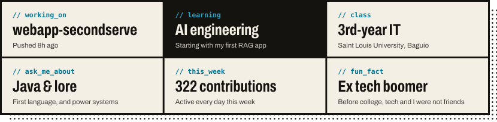</picture>

<h3><picture><source media="(prefers-color-scheme: dark)" srcset="assets/h-stats-dark.svg"></picture></h3>

<picture><source media="(prefers-color-scheme: dark)" srcset="generated/stats-dark.svg">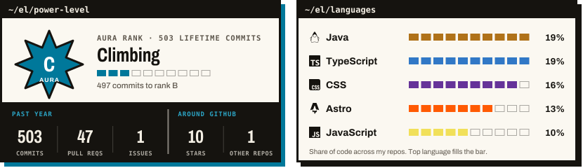</picture>

<picture><source media="(prefers-color-scheme: dark)" srcset="generated/streak-dark.svg">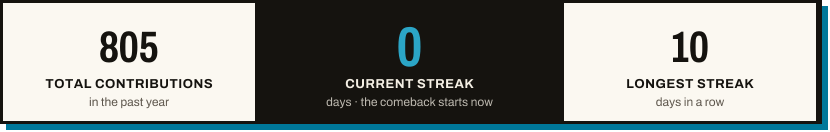</picture>

<picture><source media="(prefers-color-scheme: dark)" srcset="generated/year-dark.svg"></picture>

<h3><picture><source media="(prefers-color-scheme: dark)" srcset="assets/h-gallery-dark.svg"></picture></h3>

<picture><source media="(prefers-color-scheme: dark)" srcset="assets/gallery-dark.svg"></picture>

<h3><picture><source media="(prefers-color-scheme: dark)" srcset="assets/h-building-dark.svg"></picture></h3>

  <a href="https://github.com/malemanape/webapp-secondserve"><picture><source media="(prefers-color-scheme: dark)" srcset="generated/repo-1-dark.svg"></picture></a>
  <picture><source media="(prefers-color-scheme: dark)" srcset="generated/repo-2-dark.svg"></picture>

  <a href="https://github.com/malemanape/ThriftBite"><picture><source media="(prefers-color-scheme: dark)" srcset="generated/repo-3-dark.svg">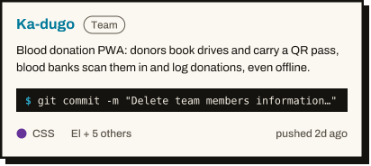</picture></a>
  <a href="https://github.com/malemanape/my-portfolio"><picture><source media="(prefers-color-scheme: dark)" srcset="generated/repo-4-dark.svg"></picture></a>

<h3><picture><source media="(prefers-color-scheme: dark)" srcset="assets/h-stack-dark.svg"></picture></h3>

  <picture><source media="(prefers-color-scheme: dark)" srcset="https://skillicons.dev/icons?i=java%2Cpython%2Cts%2Cjs%2Ckotlin%2Celixir%2Crust&theme=dark"></picture>
   
  <picture><source media="(prefers-color-scheme: dark)" srcset="https://skillicons.dev/icons?i=astro%2Creact%2Cfastapi%2Cspring%2Csupabase%2Cpostgres%2Cdocker%2Cgit&theme=dark"></picture>

<picture><source media="(prefers-color-scheme: dark)" srcset="assets/commit-dark.svg"></picture>

<picture><source media="(prefers-color-scheme: dark)" srcset="assets/dodge-dark.svg"></picture>

<a href="https://elsteven-cruz.vercel.app"><picture><source media="(prefers-color-scheme: dark)" srcset="assets/footer-dark.svg"></picture></a>

<!-- Generated by scripts/readme.py from profile.config.json. Edit the config, not this file. -->
